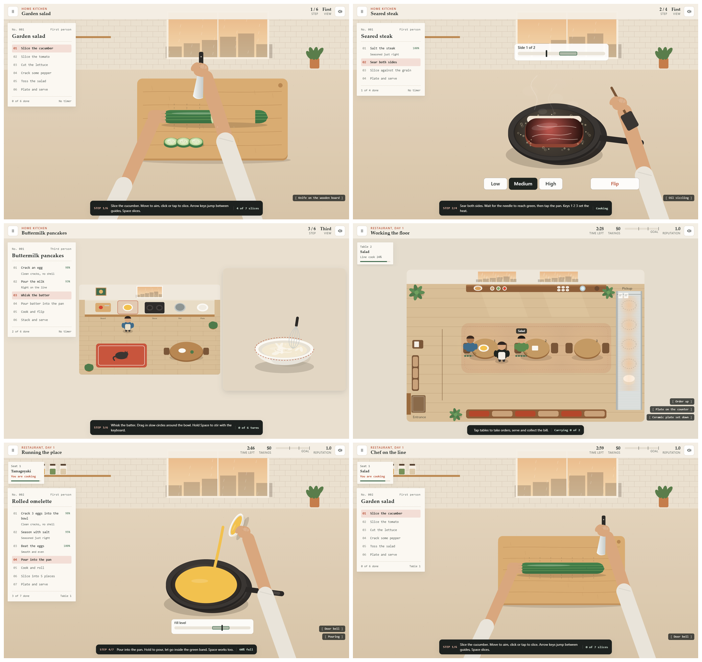
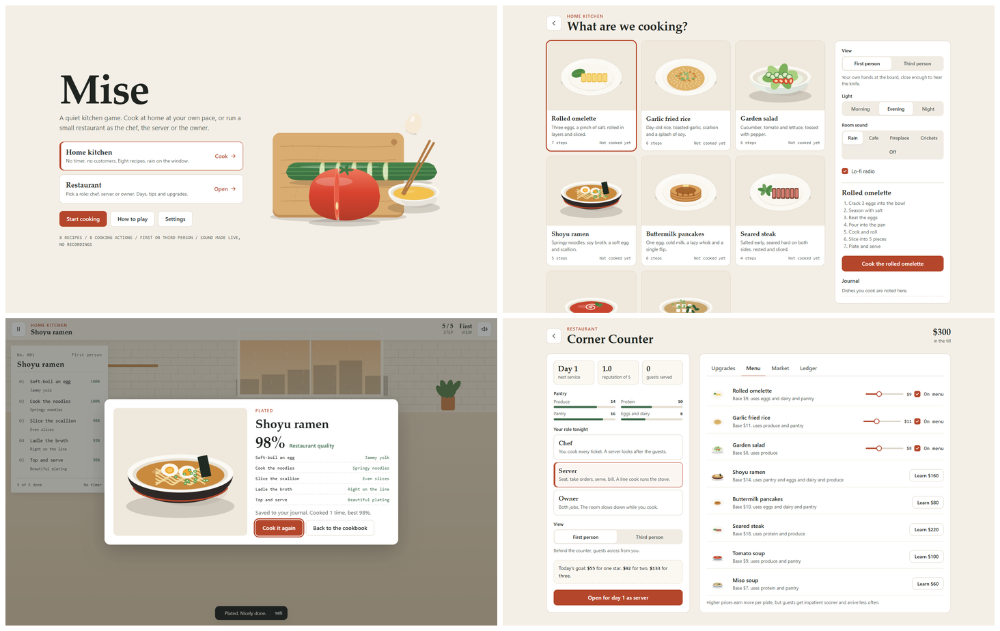
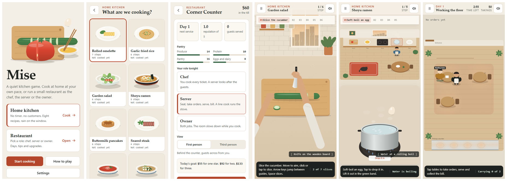

# Mise - a quiet kitchen game

**Play:** https://juw12.github.io/mise/ (or download and open `index.html` - double-click works, no install, no internet needed).

A cozy, ASMR-first cooking game: cook at home at your own pace, or run a small restaurant as the chef, the server or the owner, in first or third person. Plain HTML, CSS and JavaScript; every sound is synthesised live with Web Audio.

## What it is
- **Home kitchen**: no timer, no customers. Cook any of 8 recipes at your own pace; finished dishes go into a journal.
- **Restaurant**: short service days with a three-star goal, then manage the place.
  - **Chef**: cook every ticket on the rail; an AI server runs the floor.
  - **Server**: seat, take orders, run plates, collect the bill; an AI line cook cooks.
  - **Owner**: both jobs; the room slows while you cook.
- **First or third person** in every mode: your hands at the board, or a walking cook and a top-down dining room.
- **8 cooking actions**: slice, crack, pour, stir, fry, boil, season, plate - each scored on precision.
- **ASMR sound made live** (Web Audio): knife on wood, sizzle that follows the heat, pouring, boiling, salt, plates; rain / cafe / fireplace / crickets beds; generative lo-fi radio; optional sound captions.
- **Management**: 11 upgrades (tools, tables, staff), menu and prices, market stock, ledger, reputation, five guest types.

## Controls
Mouse or touch everywhere. Keyboard: Space / Enter main action, arrows move the knife or change heat, 1-6 act on tables, Q next guest, P pick up from the pickup counter, K cook (owner), Esc pause.

## Files
- `index.html`, `css/style.css` - shell and styles (tokens in `design.md`)
- `js/core.js` storage and profile, `js/audio.js` sound engine, `js/data.js` recipes and economy,
  `js/art.js` illustration, `js/minigames.js` cooking actions, `js/cook.js` cooking session,
  `js/restaurant.js` service simulation, `js/ui.js` screens, `js/main.js` loop and input
- `tests/check.py` - automated gates (JS errors, every recipe in both views, every role and view, overflow, contrast, no emoji, no purple)
- `docs/` - screenshots, the frozen judging rubric and the improvement log

## Quality
- `python tests/check.py` (Playwright + Edge) runs the gates: no JS errors, all 8 recipes completable in both views, every role and view finishes a day, keyboard-only play, no horizontal overflow from 320 to 1440 px, AA contrast, no emoji, no purple, saves survive reload, runs from `file://`.
- Improved over four judged rounds against a fixed rubric (cooking feel, visual polish, usability, depth, calm): 7.7 -> 8.55 from a three-model council, all gates passing. Details in `docs/refine_log.md`.

## Licence
MIT
